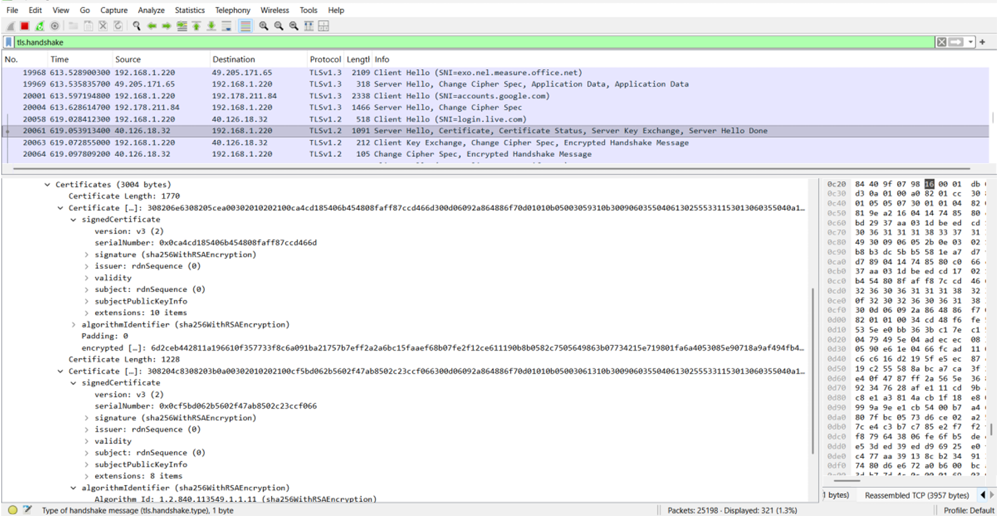
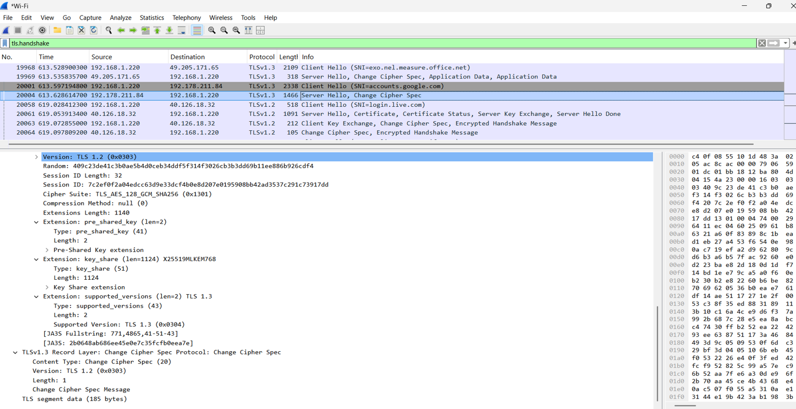

# SSL/TLS Handshake & Certificate Analysis

A practical network security investigation focused on capturing and analyzing the **SSL/TLS handshake process** and examining the **server SSL certificate** using Wireshark.

## 📌 Project Overview

This project demonstrates the practical analysis of secure web communication by capturing an SSL/TLS session using **Wireshark** while accessing `bluecloudsoftech.com`.

The investigation focuses on observing the TLS handshake, identifying the major handshake stages, and analyzing the server's X.509 certificate and certificate chain.

The captured traffic demonstrates how a secure connection is established between a client and server before encrypted application data is exchanged.

## 🎯 Objective

The primary objective of this investigation was to:

* Capture an SSL/TLS handshake using Wireshark.
* Identify the major stages involved in establishing a secure connection.
* Examine the TLS Client Hello and Server Hello messages.
* Inspect the server certificate exchanged during the handshake.
* Analyze certificate properties and the certificate chain.
* Understand what information remains visible in encrypted TLS traffic.

---

## 🛠️ Tools & Environment

| Tool / Component | Purpose                                         |
| ---------------- | ----------------------------------------------- |
| **Wireshark**    | Network packet capture and TLS traffic analysis |
| **Web Browser**  | Establishing the HTTPS connection               |
| **Windows OS**   | Analysis environment                            |
| **TLS**          | Secure communication protocol analyzed          |

---

## 🔎 Investigation Methodology

The analysis was performed using the following procedure:

1. Installed and opened Wireshark with administrative privileges.
2. Selected the active Wi-Fi network interface.
3. Started packet capture.
4. Applied the following display filter:

```text
tls
```

5. Accessed:

```text
https://bluecloudsoftech.com
```

6. Captured the TLS handshake packets generated during the HTTPS session.
7. Examined the Client Hello, Server Hello, and certificate exchange.
8. Inspected the server SSL certificate and its associated properties.
9. Stopped the capture after the session was successfully established.
10. Documented the observations and findings in the investigation report.

---

## 🔐 TLS Handshake Analysis

The packet capture revealed the following stages involved in establishing the secure connection.

### 1. TCP Three-Way Handshake

Before TLS communication begins, the underlying TCP connection is established using:

```text
SYN → SYN-ACK → ACK
```

This establishes the transport-layer connection between the client and server.

### 2. TLS Client Hello

The client initiates the TLS negotiation by sending a **Client Hello** message.

The captured packet contains handshake metadata including:

* Supported TLS version information
* Supported cipher suites
* Server Name Indication (SNI)

### 3. TLS Server Hello

The server responds with a **Server Hello** message.

This response contains the server's selections for the TLS negotiation, including:

* Selected TLS version
* Selected cipher suite

### 4. Certificate Exchange

The server certificate is exchanged during the TLS handshake.

The captured traffic showed:

* Server certificate
* Intermediate Certificate Authority (CA) certificate

The certificate allows the client to verify the identity of the server before secure communication is established.

### 5. Encrypted Communication

After completion of the handshake, secure encrypted communication is established between the client and server.

The packet capture allows handshake metadata to be observed, while the protected application data remains encrypted.

---

## 📜 SSL Certificate Analysis

The server certificate captured during the investigation was analyzed using Wireshark.

The following certificate properties were identified:

| Certificate Property    | Observation                                                   |
| ----------------------- | ------------------------------------------------------------- |
| **Certificate Type**    | X.509 v3                                                      |
| **Signature Algorithm** | SHA256 with RSA Encryption                                    |
| **Issuer**              | Certificate Authority (CA)                                    |
| **Subject**             | `bluecloudsoftech.com`                                        |
| **Serial Number**       | Unique identifier assigned by the CA                          |
| **Validity**            | Not Before and Not After dates                                |
| **Public Key**          | RSA public key                                                |
| **Extensions**          | Subject Alternative Name (SAN), Key Usage, Extended Key Usage |
| **Certificate Chain**   | Server certificate + Intermediate CA certificate              |

---

## 📸 Evidence

### TLS Handshake Capture

The following screenshot shows the captured TLS handshake traffic analyzed in Wireshark.



---

### Certificate Status

The following screenshot provides supporting evidence from the certificate analysis.



---

## 🔍 Key Findings

The investigation produced the following observations:

* TLS provides encrypted communication between the client and server.
* The SSL/TLS certificate is used to verify the identity of the website.
* The TLS handshake exposes certain connection and negotiation metadata.
* Application data transmitted after the handshake remains encrypted.
* Sensitive information such as passwords was not visible in the captured encrypted traffic.
* The certificate chain included the server certificate and an intermediate CA certificate.

---

## 🧩 Security Concepts Demonstrated

This investigation provided practical exposure to several important cybersecurity concepts:

* Network packet analysis
* HTTPS communication
* TLS handshake analysis
* Client Hello / Server Hello
* Cipher suite negotiation
* Server Name Indication (SNI)
* X.509 certificates
* Certificate Authorities (CA)
* Certificate chains
* Public-key cryptography
* Encrypted network traffic
* Wireshark TLS filtering

---

## 📂 Repository Structure

```text
SSL-TLS-Handshake-Certificate-Analysis/
│
├── README.md
│
├── Report/
│   └── SSL_TLS_Handshake_Report.pdf
│
└── Screenshots/
    ├── tls_handshake.png
    └── Certificate_Status.png
```

---

## 📄 Detailed Investigation Report

The complete investigation methodology, observations, certificate analysis, and conclusion are documented in:

**[SSL/TLS Handshake Analysis Report](Report/SSL_TLS_Handshake_Report.pdf)**

---

## ✅ Conclusion

The SSL/TLS handshake analysis was successfully performed using Wireshark.

The investigation demonstrated how a secure HTTPS connection is established through TLS negotiation, certificate exchange, certificate verification, and subsequent encrypted communication.

Analyzing the captured packets provided practical understanding of **secure web communication, TLS handshake behavior, SSL certificate structure, and network traffic visibility during encrypted sessions**.

---

## ⚠️ Scope & Note

This repository documents a controlled analysis performed for **educational and cybersecurity learning purposes**.

The analysis focuses on observing the SSL/TLS connection and certificate information available during the captured session. It does not attempt to decrypt protected application data or bypass the security mechanisms provided by TLS.

---

### 👩‍💻 Author

**Laxmi Sri Priya**

*CSE | Cyber Security*

**Focus Areas:** Digital Forensics • Network Security • Security Analysis • Cybersecurity
